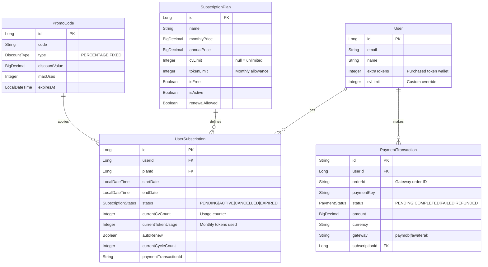
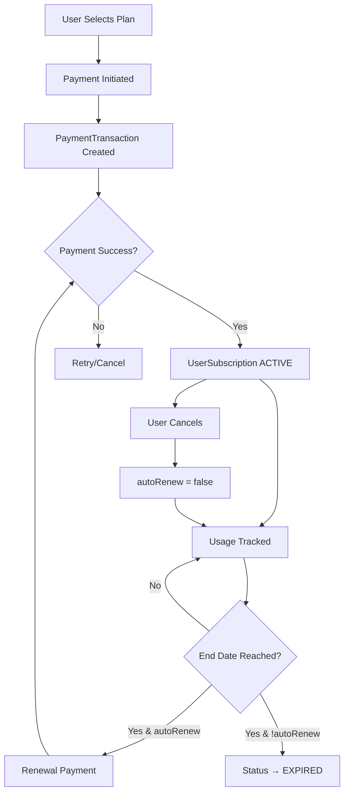
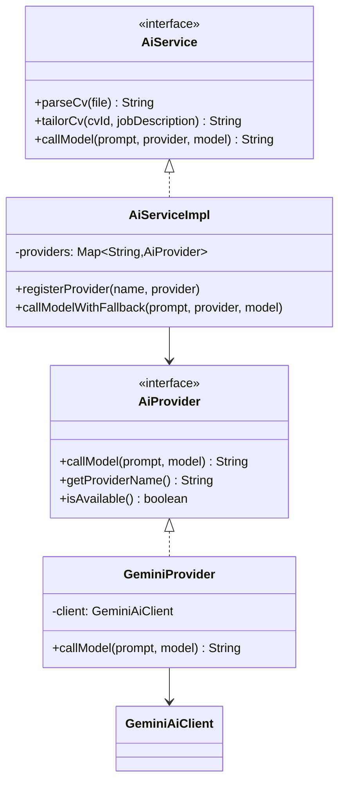

# Civify Architecture Documentation

## Entity Relationship Diagram

### Payment & Subscription System



### Subscription Lifecycle



---

## AI Service Architecture

```mermaid
flowchart TD
    subgraph Frontend
        A[Upload CV File] --> B[/api/v1/cvs/upload]
        C[Enter Job Description] --> D[/api/v1/cvs/tailor]
    end
    
    subgraph Backend["Backend (CvUseCaseImpl)"]
        B --> E[CvParsingService]
        D --> F[CvEnhancementService]
    end
    
    subgraph AI["AI Service Layer"]
        E --> G[AiServiceImpl]
        F --> G
        G --> H[GeminiAiClient]
        H --> I[Google Gemini API]
    end
    
    subgraph Logging
        E --> J[CvOperationLogService]
        F --> J
    end
    
    I --> K[Return JSON Response]
    K --> L[Parse to ResumeData]
```

### AI Provider Pattern



---

## Entity Usage Summary

| Entity | Table | Status | Purpose |
|--------|-------|--------|---------|
| **Resume** | `resumes` | ✅ ACTIVE | User-editable resume data from builder |
| **Cv** | `cvs` | ⚠️ UNUSED | Designed for AI artifacts, not populated |
| **JobApplication** | `job_applications` | ✅ ACTIVE | Tracks job applications with tailored CV |

### Cv vs Resume

- **Resume**: User's main resume data, edited via UI builder, stored as JSON
- **Cv**: Legacy/unused entity for storing raw AI parsing results

### JobApplication Flow (Enhancement Opportunity)

Current: User tailors CV → Downloads PDF → Manually tracks

**Suggested Enhancement:**
1. After tailoring, prompt "Save to Job Tracker?"
2. Create `JobApplication` with:
   - Job description user entered
   - Tailored CV reference
   - Company/title from Step 3
3. Track application status (Applied, Interview, Offer)
4. Dashboard showing all applications

---

## Environment Configuration

### Payment Gateways
- `PAYMOB_API_KEY` - Paymob authentication
- `PAYMOB_INTEGRATION_ID` - Card integration
- `PAYMOB_IFRAME_ID` - Checkout iframe
- `PAYMOB_HMAC_SECRET` - Callback verification

### AI Service
- `GEMINI_API_KEY` - Google Gemini API key
- `gemini.base.url` - API base URL
