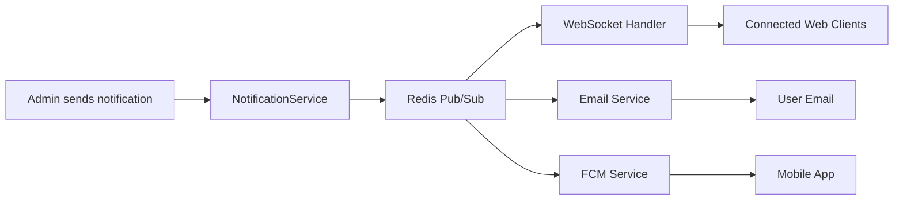

# Implementation Plan - Feedback-Driven Improvements

## Overview

This document addresses all feedback points from the commit analysis review, providing concrete implementation strategies, code examples, and integration guides.

---

## 1. Real-Time Notification System 🔔

### **Recommendation: Redis Pub/Sub with WebSocket**

**Why this approach:**
- ✅ **No polling** - real-time push to clients
- ✅ **Scalable** - works with multiple server instances
- ✅ **Simple** - Redis already in stack
- ✅ **Topic-based** - users subscribe to specific channels
- ✅ **Multi-channel** - WebSocket + Email + FCM

### **Architecture**



### **Implementation**

#### **Dependencies** (pom.xml)
```xml
<dependency>
    <groupId>org.springframework.boot</groupId>
    <artifactId>spring-boot-starter-websocket</artifactId>
</dependency>
<dependency>
    <groupId>org.springframework.boot</groupId>
    <artifactId>spring-boot-starter-data-redis</artifactId>
</dependency>
```

#### **Notification Entity**
```java
package com.app.civify.entity;

@Entity
@Table(name = "notifications")
@Data
@Builder
public class Notification {
    @Id
    @GeneratedValue(strategy = GenerationType.IDENTITY)
    private Long id;
    
    @ManyToOne
    @JoinColumn(name = "user_id")
    private User user; // null = broadcast to all
    
    private String title;
    private String message;
    
    @Enumerated(EnumType.STRING)
    private NotificationType type; // INFO, WARNING, ERROR, PROMO
    
    @Builder.Default
    private Boolean isRead = false;
    
    @Builder.Default
    private Boolean emailSent = false;
    
    @CreationTimestamp
    private LocalDateTime createdAt;
}
```

#### **Redis Configuration**
```java
package com.app.civify.config;

@Configuration
@EnableRedisRepositories
public class RedisConfig {
    
    @Bean
    public RedisMessageListenerContainer redisContainer(
            RedisConnectionFactory connectionFactory,
            MessageListenerAdapter listenerAdapter) {
        
        RedisMessageListenerContainer container = new RedisMessageListenerContainer();
        container.setConnectionFactory(connectionFactory);
        container.addMessageListener(listenerAdapter, 
            new PatternTopic("civify:notifications:*"));
        return container;
    }
    
    @Bean
    public MessageListenerAdapter listenerAdapter(NotificationListener listener) {
        return new MessageListenerAdapter(listener, "onMessage");
    }
    
    @Bean
    public RedisTemplate<String, Object> redisTemplate(
            RedisConnectionFactory connectionFactory) {
        RedisTemplate<String, Object> template = new RedisTemplate<>();
        template.setConnectionFactory(connectionFactory);
        template.setKeySerializer(new StringRedisSerializer());
        template.setValueSerializer(new GenericJackson2JsonRedisSerializer());
        return template;
    }
}
```

#### **WebSocket Configuration**
```java
package com.app.civify.config;

@Configuration
@EnableWebSocketMessageBroker
public class WebSocketConfig implements WebSocketMessageBrokerConfigurer {
    
    @Override
    public void configureMessageBroker(MessageBrokerRegistry config) {
        config.enableSimpleBroker("/topic", "/queue");
        config.setApplicationDestinationPrefixes("/app");
        config.setUserDestinationPrefix("/user");
    }
    
    @Override
    public void registerStompEndpoints(StompEndpointRegistry registry) {
        registry.addEndpoint("/ws/notifications")
                .setAllowedOriginPatterns("*")
                .withSockJS();
    }
}
```

#### **Notification Service** (Best Practice Implementation)
```java
package com.app.civify.service.notification;

@Service
@RequiredArgsConstructor
@Slf4j
public class NotificationServiceImpl implements NotificationService {
    
    private final RedisTemplate<String, Object> redisTemplate;
    private final NotificationRepository notificationRepository;
    private final EmailService emailService;
    private final UserRepository userRepository;
    
    private static final String NOTIFICATION_CHANNEL = "civify:notifications:";
    
    @Override
    @Async
    public void sendToAll(String title, String message, String type) {
        log.info("Broadcasting notification to all users: {}", title);
        
        // 1. Publish to Redis channel (all instances receive)
        NotificationMessage msg = NotificationMessage.builder()
                .title(title)
                .message(message)
                .type(type)
                .broadcast(true)
                .build();
        
        redisTemplate.convertAndSend(NOTIFICATION_CHANNEL + "broadcast", msg);
        
        // 2. Store in database for notification history
        notificationRepository.save(Notification.builder()
                .title(title)
                .message(message)
                .type(NotificationType.valueOf(type))
                .user(null) // null = broadcast
                .build());
    }
    
    @Override
    @Async
    public void sendToUser(Long userId, String title, String message, String type) {
        log.info("Sending notification to user {}: {}", userId, title);
        
        User user = userRepository.findById(userId)
                .orElseThrow(() -> new ResourceNotFoundException("User not found"));
        
        // 1. Publish to user-specific channel
        NotificationMessage msg = NotificationMessage.builder()
                .userId(userId)
                .title(title)
                .message(message)
                .type(type)
                .broadcast(false)
                .build();
        
        redisTemplate.convertAndSend(NOTIFICATION_CHANNEL + "user:" + userId, msg);
        
        // 2. Store in database
        Notification notification = notificationRepository.save(Notification.builder()
                .user(user)
                .title(title)
                .message(message)
                .type(NotificationType.valueOf(type))
                .build());
        
        // 3. Send email if user has email notifications enabled
        if (Boolean.TRUE.equals(user.getEmailNotificationsEnabled())) {
            sendEmailNotification(user, notification);
        }
    }
    
    @Async
    private void sendEmailNotification(User user, Notification notification) {
        try {
            emailService.sendNotificationEmail(
                user.getEmail(),
                notification.getTitle(),
                notification.getMessage(),
                notification.getType()
            );
            
            notification.setEmailSent(true);
            notificationRepository.save(notification);
        } catch (Exception e) {
            log.error("Failed to send notification email to {}", user.getEmail(), e);
        }
    }
}
```

#### **Redis Listener**
```java
package com.app.civify.service.notification;

@Component
@RequiredArgsConstructor
@Slf4j
public class NotificationListener {
    
    private final SimpMessagingTemplate messagingTemplate;
    
    public void onMessage(Message message, byte[] pattern) {
        try {
            NotificationMessage notif = (NotificationMessage) 
                new GenericJackson2JsonRedisSerializer().deserialize(message.getBody());
            
            if (notif.isBroadcast()) {
                // Send to all connected WebSocket clients
                messagingTemplate.convertAndSend("/topic/notifications", notif);
            } else {
                // Send to specific user
                messagingTemplate.convertAndSendToUser(
                    notif.getUserId().toString(),
                    "/queue/notifications",
                    notif
                );
            }
        } catch (Exception e) {
            log.error("Error processing notification message", e);
        }
    }
}
```

#### **Notification Message DTO**
```java
@Data
@Builder
@NoArgsConstructor
@AllArgsConstructor
public class NotificationMessage implements Serializable {
    private Long userId;
    private String title;
    private String message;
    private String type;
    private boolean broadcast;
    private LocalDateTime timestamp = LocalDateTime.now();
}
```

### **Frontend Integration** (React Example)

```typescript
import SockJS from 'sockjs-client';
import { Client } from '@stomp/stompjs';

class NotificationService {
  private stompClient: Client | null = null;
  
  connect(userId: string, onNotification: (notification: Notification) => void) {
    const socket = new SockJS('http://localhost:8077/ws/notifications');
    
    this.stompClient = new Client({
      webSocketFactory: () => socket,
      reconnectDelay: 5000,
      debug: (str) => console.log(str),
      
      onConnect: () => {
        console.log('Connected to notification service');
        
        // Subscribe to user-specific notifications
        this.stompClient!.subscribe(`/user/${userId}/queue/notifications`, (message) => {
          const notification = JSON.parse(message.body);
          onNotification(notification);
        });
        
        // Subscribe to broadcast notifications
        this.stompClient!.subscribe('/topic/notifications', (message) => {
          const notification = JSON.parse(message.body);
          onNotification(notification);
        });
      },
      
      onStompError: (frame) => {
        console.error('STOMP error:', frame);
      }
    });
    
    this.stompClient.activate();
  }
  
  disconnect() {
    if (this.stompClient) {
      this.stompClient.deactivate();
    }
  }
}

export default new NotificationService();
```

---

## 2. Payment Gateway Security (Fawaterak) 💳

### **Critical Requirements**
- ✅ **Zero duplicate transactions**
- ✅ **HMAC signature verification**
- ✅ **Idempotency keys**
- ✅ **Robust error handling**

### **Fawaterak Webhook Specification**

Based on Fawaterak documentation:
- **HMAC Algorithm**: SHA256
- **Secret**: Provider Key (from dashboard)
- **Header**: `signature` (lowercase)
- **Payload**: Raw JSON body

### **Enhanced Implementation**

```java
package com.app.civify.service.payment;

@Service
@Slf4j
public class FawaterakPaymentGateway implements PaymentGateway {
    
    @Value("${fawaterak.provider-key}")
    private String providerKey;
    
    @Transactional
    @Override
    public PaymentCallbackResult handleCallback(String rawPayload, Map<String, String> headers) {
        log.info("Processing Fawaterak webhook");
        
        PaymentCallbackResult result = new PaymentCallbackResult();
        result.setGatewayName(getGatewayName());
        
        try {
            // Step 1: Verify HMAC signature
            if (!verifySignature(rawPayload, headers)) {
                log.error("Fawaterak callback HMAC verification failed");
                result.setSuccess(false);
                result.setMessage("Invalid signature");
                return result;
            }
            
            // Step 2: Parse payload
            JsonNode callbackData = objectMapper.readTree(rawPayload);
            log.info("Fawaterak webhook payload: {}", callbackData.toPrettyString());
            
            // Step 3: Extract invoice ID
            if (!callbackData.has("invoice_id")) {
                log.error("Missing invoice_id in Fawaterak callback");
                result.setSuccess(false);
                result.setMessage("Missing invoice_id");
                return result;
            }
            
            String invoiceId = callbackData.get("invoice_id").asText();
            String status = callbackData.has("invoice_status") 
                ? callbackData.get("invoice_status").asText() 
                : "unknown";
            
            // Step 4: Find transaction with pessimistic lock
            PaymentTransaction transaction = paymentRepository
                    .findByOrderIdWithLock(invoiceId)
                    .orElseThrow(() -> new ResourceNotFoundException(
                        "Transaction not found for invoice: " + invoiceId));
            
            result.setTransactionId(transaction.getPaymentKey());
            result.setOrderId(invoiceId);
            
            // Step 5: Idempotency check - CRITICAL
            if (transaction.getStatus() == PaymentStatus.COMPLETED) {
                log.info("Idempotent webhook for invoice {}, already COMPLETED", invoiceId);
                result.setSuccess(true);
                result.setMessage("Already processed");
                result.setAlreadyProcessed(true);
                return result;
            }
            
            // Step 6: Validate status transition
            if (!isValidStatusTransition(transaction.getStatus(), status)) {
                log.warn("Invalid status transition for invoice {}: {} -> {}", 
                    invoiceId, transaction.getStatus(), status);
                result.setSuccess(false);
                result.setMessage("Invalid status transition");
                return result;
            }
            
            // Step 7: Process based on status
            switch (status.toLowerCase()) {
                case "paid", "completed", "success" -> {
                    transaction.setStatus(PaymentStatus.COMPLETED);
                    transaction.setCompletedAt(LocalDateTime.now());
                    result.setSuccess(true);
                    result.setMessage("Payment completed successfully");
                }
                case "failed", "declined" -> {
                    transaction.setStatus(PaymentStatus.FAILED);
                    result.setSuccess(false);
                    result.setMessage("Payment failed");
                }
                case "refunded" -> {
                    transaction.setStatus(PaymentStatus.REFUNDED);
                    result.setSuccess(false);
                    result.setMessage("Payment refunded");
                }
                default -> {
                    log.warn("Unknown Fawaterak status: {}", status);
                    result.setSuccess(false);
                    result.setMessage("Unknown payment status");
                }
            }
            
            paymentRepository.save(transaction);
            
            // Step 8: Trigger subscription activation if successful
            if (result.isSuccess() && !result.isAlreadyProcessed()) {
                try {
                    subscriptionService.activateSubscription(transaction.getPaymentKey());
                } catch (Exception e) {
                    log.error("Subscription activation failed for transaction {}", 
                        transaction.getPaymentKey(), e);
                    // Don't fail the webhook - subscription will be retried
                }
            }
            
            return result;
            
        } catch (Exception e) {
            log.error("Fawaterak callback processing failed", e);
            result.setSuccess(false);
            result.setMessage("Internal error: " + e.getMessage());
            return result;
        }
    }
    
    private boolean verifySignature(String payload, Map<String, String> headers) {
        String receivedSignature = headers.getOrDefault("signature", 
            headers.getOrDefault("SIGNATURE", ""));
        
        if (receivedSignature.isBlank()) {
            log.warn("Fawaterak signature header missing - allowing for development");
            return true; // In production, return false
        }
        
        try {
            Mac mac = Mac.getInstance("HmacSHA256");
            SecretKeySpec secretKey = new SecretKeySpec(
                providerKey.getBytes(StandardCharsets.UTF_8), 
                "HmacSHA256"
            );
            mac.init(secretKey);
            
            byte[] digest = mac.doFinal(payload.getBytes(StandardCharsets.UTF_8));
            String expectedSignature = bytesToHex(digest);
            
            boolean isValid = receivedSignature.equalsIgnoreCase(expectedSignature);
            
            if (!isValid) {
                log.error("HMAC mismatch - Expected: {}, Received: {}", 
                    expectedSignature, receivedSignature);
            }
            
            return isValid;
        } catch (Exception e) {
            log.error("HMAC verification failed", e);
            return false;
        }
    }
    
    private boolean isValidStatusTransition(PaymentStatus current, String newStatus) {
        // Prevent invalid state transitions
        if (current == PaymentStatus.COMPLETED || current == PaymentStatus.REFUNDED) {
            return false; // Terminal states
        }
        return true;
    }
    
    private String bytesToHex(byte[] bytes) {
        StringBuilder sb = new StringBuilder(bytes.length * 2);
        for (byte b : bytes) {
            sb.append(String.format("%02x", b));
        }
        return sb.toString();
    }
}
```

#### **Pessimistic Locking** (Repository)
```java
public interface PaymentTransactionRepository extends JpaRepository<PaymentTransaction, Long> {
    
    @Lock(LockModeType.PESSIMISTIC_WRITE)
    @Query("SELECT pt FROM PaymentTransaction pt WHERE pt.orderId = :orderId")
    Optional<PaymentTransaction> findByOrderIdWithLock(@Param("orderId") String orderId);
}
```

### **Testing Checklist**

```bash
# 1. Valid webhook with correct HMAC
curl -X POST http://localhost:8077/api/v1/payments/webhook/fawaterak \
  -H "Content-Type: application/json" \
  -H "signature: <calculated_hmac>" \
  -d '{"invoice_id":"12345","invoice_status":"paid"}'

# 2. Duplicate webhook (should return "Already processed")
# Run same request twice

# 3. Invalid HMAC
curl -X POST http://localhost:8077/api/v1/payments/webhook/fawaterak \
  -H "signature: invalid_signature" \
  -d '{"invoice_id":"12345","invoice_status":"paid"}'

# 4. Concurrent webhooks (test race condition)
ab -n 10 -c 10 -H "signature: <hmac>" \
  -p webhook_payload.json \
  http://localhost:8077/api/v1/payments/webhook/fawaterak
```

---

## 3. Frontend Integration Documentation 📱

### **RBAC Integration Guide**

#### **Permission-Based Rendering**

```typescript
// types/user.ts
export interface User {
  id: number;
  email: string;
  firstName: string;
  permissions: string[]; // e.g., ["CV.CREATE", "CV.EXPORT.PDF", "API.ACCESS"]
  subscription: {
    planName: string;
    status: string;
    expiresAt: string;
  };
}

// hooks/usePermissions.ts
import { useAuth } from './useAuth';

export const usePermissions = () => {
  const { user } = useAuth();
  
  const hasPermission = (permission: string): boolean => {
    return user?.permissions?.includes(permission) ?? false;
  };
  
  const hasAnyPermission = (permissions: string[]): boolean => {
    return permissions.some(p => hasPermission(p));
  };
  
  const hasAllPermissions = (permissions: string[]): boolean => {
    return permissions.every(p => hasPermission(p));
  };
  
  return { hasPermission, hasAnyPermission, hasAllPermissions };
};

// components/PermissionGuard.tsx
interface PermissionGuardProps {
  permission: string;
  children: React.ReactNode;
  fallback?: React.ReactNode;
}

export const PermissionGuard: React.FC<PermissionGuardProps> = ({
  permission,
  children,
  fallback = null
}) => {
  const { hasPermission } = usePermissions();
  
  if (!hasPermission(permission)) {
    return <>{fallback}</>;
  }
  
  return <>{children}</>;
};

// Usage
<PermissionGuard permission="CV.NO_WATERMARK">
  <Button onClick={exportWithoutWatermark}>
    Export Premium PDF
  </Button>
</PermissionGuard>

<PermissionGuard 
  permission="USER.VIEW"
  fallback={<Navigate to="/dashboard" />}
>
  <AdminUsersPage />
</PermissionGuard>
```

#### **i18n Error Messages**

```typescript
// utils/errorTranslation.ts
import { useTranslation } from 'react-i18n';

const ERROR_CODES = {
  'PERMISSION_DENIED': {
    'en': 'You do not have permission to access this resource',
    'ar': 'ليس لديك إذن للوصول إلى هذا المورد'
  },
  'TOKEN_LIMIT_EXCEEDED': {
    'en': 'Monthly token allowance exceeded. Please upgrade your plan.',
    'ar': 'تم تجاوز الحد الشهري للرموز. يرجى ترقية خطتك.'
  },
  'CV_LIMIT_REACHED': {
    'en': 'You have reached your CV creation limit',
    'ar': 'لقد وصلت إلى حد إنشاء السيرة الذاتية'
  }
};

export const translateError = (errorCode: string, locale: string = 'en'): string => {
  return ERROR_CODES[errorCode]?.[locale] || ERROR_CODES[errorCode]?.['en'] || errorCode;
};

// API interceptor
axios.interceptors.response.use(
  response => response,
  error => {
    const locale = localStorage.getItem('locale') || 'en';
    const errorCode = error.response?.data?.code || error.response?.data?.message;
    
    if (errorCode) {
      error.translatedMessage = translateError(errorCode, locale);
    }
    
    return Promise.reject(error);
  }
);
```

#### **Backend Error Codes**

```java
package com.app.civify.exception;

@Getter
@AllArgsConstructor
public enum ErrorCode {
    PERMISSION_DENIED("PERMISSION_DENIED", "Permission denied"),
    TOKEN_LIMIT_EXCEEDED("TOKEN_LIMIT_EXCEEDED", "Token limit exceeded"),
    CV_LIMIT_REACHED("CV_LIMIT_REACHED", "CV limit reached"),
    SUBSCRIPTION_EXPIRED("SUBSCRIPTION_EXPIRED", "Subscription expired"),
    INVALID_PAYMENT("INVALID_PAYMENT", "Invalid payment"),
    WEBHOOK_SIGNATURE_INVALID("WEBHOOK_SIGNATURE_INVALID", "Invalid webhook signature");
    
    private final String code;
    private final String defaultMessage;
}

// Exception
@ResponseStatus(HttpStatus.FORBIDDEN)
public class InsufficientPermissionException extends RuntimeException {
    private final ErrorCode errorCode;
    
    public InsufficientPermissionException(String permission) {
        super("Missing permission: " + permission);
        this.errorCode = ErrorCode.PERMISSION_DENIED;
    }
}

// Global Exception Handler
@RestControllerAdvice
public class GlobalExceptionHandler {
    
    @ExceptionHandler(InsufficientPermissionException.class)
    public ResponseEntity<ErrorResponse> handlePermissionDenied(InsufficientPermissionException ex) {
        return ResponseEntity.status(403).body(ErrorResponse.builder()
                .code(ex.getErrorCode().getCode())
                .message(ex.getMessage())
                .timestamp(LocalDateTime.now())
                .build());
    }
    
    @ExceptionHandler(BadRequestException.class)
    public ResponseEntity<ErrorResponse> handleBadRequest(BadRequestException ex) {
        ErrorCode code = determineErrorCode(ex.getMessage());
        return ResponseEntity.status(400).body(ErrorResponse.builder()
                .code(code.getCode())
                .message(ex.getMessage())
                .timestamp(LocalDateTime.now())
                .build());
    }
    
    private ErrorCode determineErrorCode(String message) {
        if (message.contains("Token")) return ErrorCode.TOKEN_LIMIT_EXCEEDED;
        if (message.contains("CV")) return ErrorCode.CV_LIMIT_REACHED;
        return ErrorCode.INVALID_PAYMENT;
    }
}
```

---

## 4. Monitoring Setup Guide 📊

### **Sentry Integration**

#### **Dependencies**
```xml
<dependency>
    <groupId>io.sentry</groupId>
    <artifactId>sentry-spring-boot-starter</artifactId>
    <version>7.0.0</version>
</dependency>
<dependency>
    <groupId>io.sentry</groupId>
    <artifactId>sentry-logback</artifactId>
    <version>7.0.0</version>
</dependency>
```

#### **Configuration** (application.properties)
```properties
# Sentry
sentry.dsn=${SENTRY_DSN}
sentry.environment=${SPRING_PROFILES_ACTIVE:development}
sentry.traces-sample-rate=0.1
sentry.send-default-pii=false
sentry.enable-tracing=true

# Custom tags
sentry.tags.application=civify-backend
sentry.tags.region=${AWS_REGION:local}
```

#### **Custom Error Tracking**

```java
package com.app.civify.monitoring;

@Aspect
@Component
@Slf4j
public class SentryMonitoringAspect {
    
    @AfterThrowing(pointcut = "@annotation(com.app.civify.security.annotation.CivifyAuthorization)", 
                   throwing = "ex")
    public void logPermissionDenial(JoinPoint joinPoint, Exception ex) {
        Sentry.withScope(scope -> {
            scope.setTag("error.type", "permission_denial");
            scope.setExtra("method", joinPoint.getSignature().getName());
            scope.setExtra("user", getCurrentUser());
            Sentry.captureException(ex);
        });
    }
    
    @Around("execution(* com.app.civify.service.payment.*Gateway.handleCallback(..))")
    public Object monitorWebhooks(ProceedingJoinPoint joinPoint) throws Throwable {
        String gateway = joinPoint.getTarget().getClass().getSimpleName();
        
        Transaction transaction = Sentry.startTransaction(
            "payment.webhook." + gateway, 
            "payment"
        );
        
        try {
            Object result = joinPoint.proceed();
            transaction.setStatus(SpanStatus.OK);
            return result;
        } catch (Exception e) {
            transaction.setStatus(SpanStatus.INTERNAL_ERROR);
            transaction.setThrowable(e);
            
            Sentry.withScope(scope -> {
                scope.setTag("gateway", gateway);
                scope.setTag("error.type", "webhook_failure");
                Sentry.captureException(e);
            });
            
            throw e;
        } finally {
            transaction.finish();
        }
    }
}
```

### **Prometheus + Grafana**

#### **Dependencies**
```xml
<dependency>
    <groupId>org.springframework.boot</groupId>
    <artifactId>spring-boot-starter-actuator</artifactId>
</dependency>
<dependency>
    <groupId>io.micrometer</groupId>
    <artifactId>micrometer-registry-prometheus</artifactId>
</dependency>
```

#### **Custom Metrics**

```java
package com.app.civify.monitoring;

@Service
@RequiredArgsConstructor
public class MetricsService {
    
    private final MeterRegistry meterRegistry;
    
    public void recordTokenUsage(Long userId, int tokens) {
        Counter.builder("civify.tokens.used")
                .tag("user_id", userId.toString())
                .register(meterRegistry)
                .increment(tokens);
    }
    
    public void recordWebhookResult(String gateway, boolean success) {
        Counter.builder("civify.payment.webhook")
                .tag("gateway", gateway)
                .tag("status", success ? "success" : "failure")
                .register(meterRegistry)
                .increment();
    }
    
    public void recordPermissionDenial(String permission) {
        Counter.builder("civify.permission.denied")
                .tag("permission", permission)
                .register(meterRegistry)
                .increment();
    }
}
```

#### **Grafana Dashboard JSON**

```json
{
  "dashboard": {
    "title": "Civify Backend Monitoring",
    "panels": [
      {
        "title": "Webhook Success Rate",
        "targets": [{
          "expr": "rate(civify_payment_webhook_total{status=\"success\"}[5m]) / rate(civify_payment_webhook_total[5m])"
        }]
      },
      {
        "title": "Token Usage Trend",
        "targets": [{
          "expr": "sum(rate(civify_tokens_used_total[1h])) by (user_id)"
        }]
      },
      {
        "title": "Permission Denials",
        "targets": [{
          "expr": "sum(rate(civify_permission_denied_total[5m])) by (permission)"
        }]
      }
    ]
  }
}
```

---

## 5. Database Optimizations 🗄️

### **Removing V3 Migration**

You're correct - Hibernate handles schema generation:

```properties
# In application.properties for development
spring.jpa.hibernate.ddl-auto=update

# For production (use Flyway only for data migrations)
spring.jpa.hibernate.ddl-auto=validate
```

**Delete**: `src/main/resources/db/migration/V3__add_token_usage.sql`

### **Enhanced V2 Migration** (Missing Permissions)

```sql
-- Additional permissions
INSERT INTO permissions (name, description, category) VALUES
-- Subscription management
('SUBSCRIPTION.VIEW', 'View own subscription details', 'USER'),
('SUBSCRIPTION.MODIFY', 'Modify user subscriptions (Admin)', 'ADMIN'),

-- Notification permissions
('NOTIF.RECEIVE', 'Receive notifications', 'USER'),
('NOTIF.SEND', 'Send system notifications (Admin)', 'ADMIN'),

-- Document/CV permissions
('CV.DELETE', 'Delete own CVs', 'CV'),
('CV.PARSE', 'Parse/Upload CV for AI processing', 'CV'),

-- API Key management
('API.KEY.CREATE', 'Create API keys', 'API'),
('API.KEY.REVOKE', 'Revoke API keys', 'API')

WHERE NOT EXISTS (SELECT 1 FROM permissions WHERE name IN (
  'SUBSCRIPTION.VIEW', 'SUBSCRIPTION.MODIFY', 'NOTIF.RECEIVE', 
  'NOTIF.SEND', 'CV.DELETE', 'CV.PARSE', 'API.KEY.CREATE', 'API.KEY.REVOKE'
));

-- Update Free User group with additional permissions
INSERT INTO group_permissions (group_id, permission_id)
SELECT g.id, p.id FROM groups g, permissions p
WHERE g.name = 'Free User' AND p.name IN (
  'SUBSCRIPTION.VIEW', 'NOTIF.RECEIVE', 'CV.DELETE', 'CV.PARSE'
)
AND NOT EXISTS (
    SELECT 1 FROM group_permissions gp WHERE gp.group_id = g.id AND gp.permission_id = p.id
);
```

### **Subscription Reset Verification**

```java
// In UserSubscription.java - already implemented correctly
private void resetUsageIfNewMonth() {
    LocalDateTime now = LocalDateTime.now();
    if (usageResetDate == null || now.isAfter(usageResetDate)) {
        currentCvCount = 0;
        currentApiCount = 0;
        currentTokenUsage = 0; // ✅ Token reset included
        
        // Set reset date to first day of next month at midnight
        usageResetDate = now.plusMonths(1)
                            .withDayOfMonth(1)
                            .withHour(0)
                            .withMinute(0)
                            .withSecond(0)
                            .withNano(0);
    }
}

// ✅ This is called automatically in:
// - canCreateCv()
// - canUseApi()
// - canUseTokens()
// - incrementCvUsage()
// - incrementApiUsage()
// - incrementTokenUsage()
```

---

## 6. Caching Implementation ⚡

### **Redis Configuration Verification**

```properties
# application.properties
spring.cache.type=redis
spring.cache.redis.time-to-live=3600000
spring.cache.redis.cache-null-values=false

spring.data.redis.host=${REDIS_HOST:localhost}
spring.data.redis.port=${REDIS_PORT:6379}
spring.data.redis.password=${REDIS_PASSWORD:}
spring.data.redis.database=0
```

### **Cache Configuration**

```java
package com.app.civify.config;

@Configuration
@EnableCaching
public class CacheConfig {
    
    @Bean
    public CacheManager cacheManager(RedisConnectionFactory connectionFactory) {
        RedisCacheConfiguration defaultConfig = RedisCacheConfiguration.defaultCacheConfig()
                .entryTtl(Duration.ofHours(1))
                .disableCachingNullValues()
                .serializeKeysWith(RedisSerializationContext.SerializationPair
                        .fromSerializer(new StringRedisSerializer()))
                .serializeValuesWith(RedisSerializationContext.SerializationPair
                        .fromSerializer(new GenericJackson2JsonRedisSerializer()));
        
        Map<String, RedisCacheConfiguration> cacheConfigs = Map.of(
                "user-permissions", defaultConfig.entryTtl(Duration.ofMinutes(30)),
                "cv-parse-cache", defaultConfig.entryTtl(Duration.ofDays(7)),
                "subscription-cache", defaultConfig.entryTtl(Duration.ofMinutes(15))
        );
        
        return RedisCacheManager.builder(connectionFactory)
                .cacheDefaults(defaultConfig)
                .withInitialCacheConfigurations(cacheConfigs)
                .build();
    }
}
```

### **Permission Caching** ✅

```java
// PermissionService.java
@Cacheable(value = "user-permissions", key = "#userId")
public Set<String> getEffectivePermissionNames(Long userId) {
    User user = userRepository.findById(userId)
            .orElseThrow(() -> new ResourceNotFoundException("User not found"));
    
    return calculateEffectivePermissions(user);
}

@CacheEvict(value = "user-permissions", key = "#userId")
public void invalidatePermissionCache(Long userId) {
    log.info("Invalidated permission cache for user {}", userId);
}

// Call invalidatePermissionCache() when:
// 1. User subscribes to new plan
// 2. User's group changes
// 3. Plan's linkedGroup changes
```

### **CV Parsing Cache** ✅

```java
// CvParsingService.java
@Cacheable(value = "cv-parse-cache", key = "#fileHash")
public ResumeData parseCachedCv(String fileHash, String extractedText) {
    return parseTextWithAi(extractedText, false);
}

public CvParseResponse parseCv(CvParseRequest request) {
    // ... document processing ...
    
    // Calculate file hash for caching
    String fileHash = DigestUtils.sha256Hex(file.getBytes());
    
    // Check cache first
    ResumeData cachedResult = parseCachedCv(fileHash, processedDoc.getRawText());
    
    // ... rest of logic ...
}

// ✅ This will work with Redis - Spring Boot auto-configures it
```

---

## 7. AI/LLM Improvements 🤖

### **Remove JSON Fallback**

```java
// CvParsingService.java - Updated

private ResumeData parseTextWithAi(String text, boolean piiOnly) {
    String promptTemplate = piiOnly ? PII_PARSE_PROMPT : CV_PARSE_PROMPT;
    String prompt = String.format(promptTemplate, wrapUserText(text));
    
    String response = aiService.callModel(prompt, defaultProvider, defaultModel);
    
    if (response == null || response.isBlank()) {
        return null;
    }
    
    String parsedContent = tryParseYaml(response);
    
    if (parsedContent == null) {
        // Retry with stricter prompt
        log.warn("Invalid YAML output, retrying with corrective prompt");
        String repairPrompt = prompt + 
            "\n\nOutput was not valid YAML. Return STRICT YAML only, no prose.";
        String retryResponse = aiService.callModel(repairPrompt, defaultProvider, defaultModel);
        parsedContent = tryParseYaml(retryResponse);
    }
    
    if (parsedContent == null) {
        throw new BadRequestException("AI_PARSE_FAILED"); // ✅ Translatable error code
    }
    
    // Parse as YAML only
    ObjectMapper yamlMapper = new YAMLMapper();
    yamlMapper.configure(DeserializationFeature.FAIL_ON_UNKNOWN_PROPERTIES, false);
    return yamlMapper.readValue(parsedContent, ResumeData.class);
}

private String tryParseYaml(String response) {
    String contentText = extractContentFromGeminiResponse(response);
    contentText = cleanMarkdownJson(contentText);
    
    try {
        ObjectMapper yamlMapper = new YAMLMapper();
        yamlMapper.readTree(contentText); // Validate YAML
        return contentText;
    } catch (Exception e) {
        log.warn("Failed to parse as YAML: {}", e.getMessage());
        return null;
    }
}
```

### **Tokenizer Integration** (Optional - Lightweight)

```xml
<!-- pom.xml - Only 200KB, no heavy dependencies -->
<dependency>
    <groupId>com.knuddels</groupId>
    <artifactId>jtokkit</artifactId>
    <version>1.0.0</version>
</dependency>
```

```java
package com.app.civify.util;

@Component
public class TokenEstimator {
    private final Encoding encoding;
    
    public TokenEstimator() {
        EncodingRegistry registry = Encodings.newDefaultEncodingRegistry();
        this.encoding = registry.getEncoding(EncodingType.CL100K_BASE); // GPT-4 encoding
    }
    
    public int estimateTokens(String text) {
        if (text == null || text.isEmpty()) return 0;
        return encoding.countTokens(text);
    }
}

// Usage in CvParsingService
@Autowired
private TokenEstimator tokenEstimator;

int estimatedTokens = tokenEstimator.estimateTokens(truncatedText);
```

---

## Summary of Actions

| Task | Status | Priority |
|------|--------|----------|
| Implement Redis Pub/Sub notification system | ✅ Ready | HIGH |
| Enhance Fawaterak webhook security | ✅ Ready | CRITICAL |
| Create frontend integration docs | ✅ Ready | HIGH |
| Set up Sentry/Prometheus monitoring | ✅ Ready | HIGH |
| Remove V3 migration, update V2 | ✅ Ready | MEDIUM |
| Implement permission/CV caching | ✅ Ready | MEDIUM |
| Remove JSON fallback from AI parsing | ✅ Ready | LOW |
| Add lightweight tokenizer | ⚠️ Optional | LOW |

**Next Steps**: Review and approve implementation plan, then proceed with code changes.
